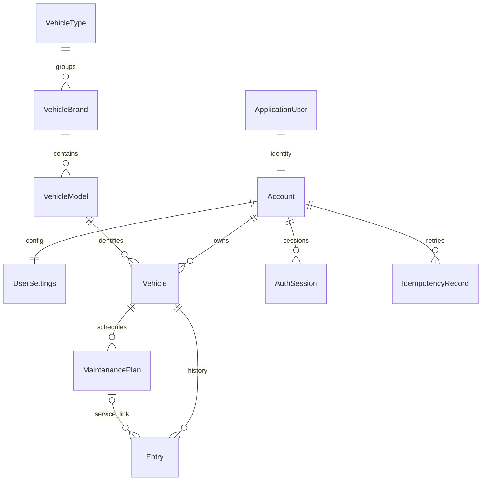

# Entity và database

Fuel/service #32/#33/#42: [schema và migration](cost-records.md) thêm ServiceItem,
hai source FK nullable unique/cascade trên OdometerReading và backfill legacy.
GET manual readings tách source; CurrentOdo vẫn tính toàn bộ. Migration chưa apply live.

Vehicle registration thiết kế mới tại [vehicle-registration-schema.md](vehicle-registration-schema.md):
VehicleType enum, Brand/Model normalized names, composite FK, optional metadata,
Odometer rename/backfill và precision. Loại bỏ SpeedLimit/HasTwoTanks; không
thêm trạng thái bảo dưỡng vào Vehicle. Migration chưa được apply NAS.

Registration/email hiện dùng hai transaction: tạo Identity user + Account +
settings + User role rồi commit; phát hành token/gửi verification riêng. SMTP
lỗi không rollback account, EmailConfirmed vẫn false. Không thêm bảng hoặc
migration; xem [kế hoạch](registration-email-recovery.md).

Owner constraint trigger đã sửa trong migration
`20261109073130_FixVehicleOwnerConstraintTrigger`: hàm chung lấy `NEW.Id` khi
trigger thuộc vehicles, lấy NEW/OLD.VehicleId khi thuộc vehicle_members.
Kiểm ở cuối transaction và kiểm cả VehicleId cũ/mới; không được bỏ constraint
để tránh lỗi binding cột. Bản sửa chỉ CREATE OR REPLACE FUNCTION, không đổi dữ liệu.

> **Runtime #58:** các entity/migration sharing hiện có được dùng cho membership,
> invitation và audit API. Auth verification/reset dùng Identity UserTokens đã
> tồn tại: provider `iCareX.AccountActions`, hash-only, một token hiện hành cho
> mỗi user/purpose; không thêm schema trong phần service/API này.
> Account mới EmailConfirmed=false; legacy confirmed không tự bị reset.
> Xem [runtime contract và transaction](access-control.md).

> **Cập nhật 09/11/2026:** ERD/properties bên dưới là **model hiện có**.
> Đích auth/access chuyển từ owner-only sang membership theo xe, xem
> [dictionary mở rộng](../schema-database.md#auth-sharing-schema) và
> [permission/flows](../authentication-authorization.md). Không tạo Users mới;
> user_id/actor/creator ánh xạ Account.Id = Identity User.Id.
>
> Bổ sung đích gồm account lifecycle, VehicleMember/VehicleInvitation,
> ownership-transfer handshake, record creator/assignee và AuditLog.
> Revoke/transfer không đổi CreatedBy hoặc xóa lịch sử. FK ghép AccountId hiện
> tại cần kế hoạch chuyển trước sharing, không dùng actor thay owner scope.
> Partial unique active Owner chỉ chặn Owner thứ hai; phải ép ít nhất một tại
> commit. Không dùng cascade Account/member deletion cho lịch sử xe chia sẻ.

## Property

Entity nghiệp vụ có CreatedAtUtc/UpdatedAtUtc; default chỉ khởi tạo lúc new object. Use case sau này phải cập nhật UpdatedAtUtc.

| Entity | Properties | Frontend |
|---|---|---|
| Account | Id:Guid, Name, Phone, GarageRevision:long | Account/profile; email từ Identity |
| UserSettings | AccountId PK, Reminders:bool=true, ThresholdKm:decimal=500, ThresholdDays:int=30 | Garage.settings |
| VehicleType | Id, Code, Name, IsActive | Catalog loại xe; seed `CAR`/`MOTORCYCLE`, quản trị Admin |
| VehicleBrand | Id, VehicleTypeId, Name, IsActive | Hãng xe thuộc đúng loại xe |
| VehicleModel | Id, VehicleBrandId, Name, IsActive | Dòng xe thuộc đúng hãng |
| Vehicle | Id, AccountId, Name, Plate, PlateNormalized, VehicleModelId, Year:int, BaseOdo:decimal, ImageUrl, ArchivedAtUtc? | Vehicle; tên do user đặt, type/brand/model suy ra từ catalog |
| OdometerReading / FuelEntry / MaintenanceRecord | Typed tables replacing legacy Entry; direct `CreatedByUserId` and nullable `DriverUserId` FKs to Identity user; ODO/Fuel/Service-specific fields | ODO history remains available; legacy rows are copied before `entries` is dropped |
| MaintenancePlan | Id, AccountId, VehicleId, Title, DueDate:DateOnly, DueOdo/IntervalKm:decimal, IntervalMonths:int | Plan; dueDate/dueOdo là hạn đầu |
| ApplicationUser | IdentityUser<Guid>: Email, NormalizedEmail, UserName, NormalizedUserName, PasswordHash, SecurityStamp, lockout... | Infrastructure; không lộ password hash |
| AuthSession | Id, AccountId, ProtectedTicket, CreatedAtUtc, ExpiresAtUtc, RevokedAtUtc? | Nền tảng phiên |
| IdempotencyRecord | AccountId+Key PK, RequestHash, ResponseStatus, ResponseBody, ResponseETag, CreatedAtUtc, ExpiresAtUtc | Nền tảng retry |

ID Guid server sinh, PostgreSQL uuid; JSON opaque string. Ngày date, audit timestamptz UTC.
decimal numeric(20,6); giữ cost phần lẻ form hiện cho phép, hiển thị VNĐ như frontend.
Precision dư reject trước DB (PostgreSQL numeric tự round nếu không validate).
Không lưu current ODO/tổng chi/trạng thái/hạn kế tiếp.

## Constraints và indexes

- Unique NormalizedEmail/UserName; Account FK Identity cùng ID; settings 1:1 Account.
- Catalog global: unique type code, `(VehicleTypeId, BrandName)` và `(VehicleBrandId, ModelName)`.
- Vehicle FK `VehicleModelId`; compatibility được bảo đảm qua model → brand → type và service chỉ nhận model active.
- Unique vehicle (AccountId, PlateNormalized), kể cả archive. Normalization tương đương JS /\W/g (ASCII word, giữ underscore).
- Vehicle alternate key (AccountId, Id); plan alternate key (AccountId, VehicleId, Id).
- Entry/plan composite FK về vehicle; entry composite FK về plan bảo đảm cùng owner và xe.
- CHECK ODO/cost/liters, kind, plan chỉ service, interval/thresholds/type/year tối thiểu/revision.
- Index entries (AccountId,VehicleId,Date,Odo), (AccountId,PlanId,Date,Odo); plans owner/vehicle; session/idempotency expiry.
- Delete plan unlink entry trước trong transaction, FK NoAction; không composite SET NULL vì sẽ null owner/vehicle.
- Delete xe cascade typed records/plans. Archive và ODO liên bản ghi là application/domain checks trong transaction.
- Vehicle creation/backfill creates an active `VehicleMember` Owner. PostgreSQL partial unique indexes plus a deferred constraint trigger enforce exactly one active Owner at commit.
- `VehicleInvitation`, `Reminder`, `Notification` and `AuditLog` are mapped
  persistence entities. Invitations store only `TokenHash`; pending invites
  are unique by vehicle and normalized email. History and actor FKs use
  restrictive deletes.
- Ngày tương lai, year tối đa động, trim/title/phone và precision được enforce ở use case khi bổ sung API, không tuyên bố DB đã kiểm tra hết.

## Migrations

Migration nằm Infrastructure. `scripts/be.ps1 migration -Name <Name>` tạo; `migrate` áp dụng chủ đích.
Không EnsureCreated ở runtime/test; không seed demo.
Trước schema change: review SQL, backup database có dữ liệu, test trên database riêng.
Rollback bằng EF database update migration trước chỉ sau review data loss; rollback initial xóa bảng, không chạy tùy tiện trên NAS.

## Sau refactor iCareX

Domain entities remain under src/iCareX.Domain/Entities, EF mapping under src/iCareX.Infrastructure/Persistence. Public transport DTOs now live in src/iCareX.Shared/Contracts; moving DTOs is not a persistence/schema change. Migration IDs and DDL are retained; EF reports no pending model changes after the CLR namespace update.
